# Mirror Bridge

**Write C++ once, bind everywhere — automatically.**

[](https://github.com/FranciscoThiesen/mirror_bridge/actions/workflows/test.yml)
[](https://github.com/FranciscoThiesen/mirror_bridge/releases)
[](LICENSE)

Generate Python, Lua, JavaScript and C# bindings from C++ using C++26 reflection. Zero boilerplate, zero runtime overhead, zero binding code.



> C++26 reflection ships in **stock GCC 16.1+** (`g++ -std=c++26 -freflection`); [Bloomberg's clang-p2996](https://github.com/bloomberg/clang-p2996) also works. The CLI auto-detects whichever is present. Reflection was voted into C++26 in June 2025 — this is standard C++, not a fork-only experiment.

## One C++ Class, Four Languages

```cpp
struct Calculator {
    double value = 0.0;
    double add(double x) { return value += x; }
    double subtract(double x) { return value -= x; }
};
```

```bash
mirror_bridge generate src/ --module calc --lang all     # Python, Lua, JavaScript
mirror_bridge generate src/ --module calc --lang csharp  # C# (a .cs + .so + .h, so not part of `all`)
```

That is the entire binding process — no `.def()`, no macros in your class, no wrapper files. The same `Calculator` is now native in all four languages:

**Python**
```python
import calc
c = calc.Calculator()
c.add(10)
print(c.value)   # 10.0
```

**Lua**
```lua
package.cpath = "build/lua/?.so;" .. package.cpath
local calc = require("calc")
local c = calc.Calculator()
c:add(10)
print(c.value)   -- 10.0
```

**JavaScript (Node.js)**
```javascript
const calc = require('./build/calc.node');
const c = new calc.Calculator();
c.add(10);
console.log(c.value);   // 10.0
```

**C#**
```csharp
using calc;

// The object owns C++ memory, so it is IDisposable.
using var c = new Calculator();
c.add(10);
Console.WriteLine(c.value);   // 10
```

## Proof on a Real Library: Open3D

We ported [Open3D](https://github.com/isl-org/Open3D)'s geometry module — the same API surface that takes **25,262 lines of hand-written pybind11** upstream — with **71 generated lines and one command** ([full case study](https://chico.dev/Mirror-Bridge-Open3D-71-Lines/), [runnable example](examples/open3d-port/)):

```bash
cd examples/open3d-port
mirror_bridge generate src/ --module open3d_geometry --lang all -I /usr/include/eigen3
```

And it's not a slower convenience layer: on the identical C++ compiled with identical flags, ingesting a 1M-point cloud from Python (`list of [x,y,z]` → `std::vector<Eigen::Vector3d>`) runs **42x faster than the pybind11 binding** (12.2ms vs 509ms), because the reflection-generated converter is specialized at compile time instead of dispatching through generic type casters ([fair-comparison methodology](asm_study/)).

### And on thirty-one libraries we didn't pick

Open3D is a case we worked, so on its own it proves only that it can be done.
To make the claim falsifiable instead, CI runs the same one-line command every
week against a corpus of unmodified third-party libraries and publishes the
result, failures included: **[the compatibility
matrix](docs/internals/compatibility.md)**.

Today that page is mostly a work queue, which is the reason to publish it. The
discovery half holds up — reflection reads the headers and reports the real
class list without anyone naming a class by hand, 23 in jsoncpp, 41 in
yaml-cpp, 108 in spdlog — and the matrix then says, per library, exactly what
stops a module coming out, grouped so the most valuable thing to fix is the
line with the most libraries on it. pybind11 and nanobind have nothing to put
in that first column, because the class list is the thing their user writes.

### Pointing it at a large codebase

Large projects do not fail to bind because binding is hard. They fail because their
headers do not parse without the include paths and defines their own build system
passes. `--compile-commands` reads those from the build instead of asking you to restate
them:

```bash
cmake -S . -B build -DCMAKE_EXPORT_COMPILE_COMMANDS=ON
mirror_bridge generate include/mylib --module mylib --lang python \
    --compile-commands build/compile_commands.json --discover-only --json
```

`--discover-only` stops after reading the headers and reports what it found, including
whether the class list came from reflection or from a fallback text scan. That is the
number that says whether a codebase is ready, and it costs one pass instead of a module
per class. MSVC and clang-cl flag spellings are translated, and `--replace-prefix` maps a
build database written on one machine onto the paths of another.
[Details](docs/reference/cli.md#large-codebases).

## Try It Now

No installation required — run in your browser or with Docker:

**[Interactive Playground](docs/playground.md)** - Godbolt examples showing C++26 reflection in action

**GitHub Codespaces** (browser-based, ~2 min):

[](https://codespaces.new/FranciscoThiesen/mirror_bridge)

**Docker** (local, one command):

```bash
docker run -it --rm -v $(pwd):/workspace ghcr.io/franciscothiesen/mirror_bridge:latest
```

Then inside the container:
```bash
cd examples/01-hello-world
../../tools/mirror_bridge generate src/ --module greeter --lang python
python3 test_greeter.py
```

## Quick Start

```bash
# 1. Get the environment
./start_dev_container.sh  # Choose option 1 for pre-built image

# 2. Verify
./tests/run_all_tests.sh

# 3. Try an example
cd examples/01-hello-world
../../tools/mirror_bridge generate src/ --module greeter --lang python
python3 test_greeter.py
```

**[Full Quick Start Guide →](docs/getting-started/quickstart.md)**

## Features

### Language Support

| Language | Status | Auto-Discovery |
|----------|--------|----------------|
| Python | Stable | `--lang python` |
| Lua | Stable | `--lang lua` |
| JavaScript (Node.js) | Stable | `--lang js` |
| C# (.NET) | Stable for scalars, strings, enums, objects and vectors | `--lang csharp` |
| Rust | Prototype | Code generation |

C# goes through P/Invoke, so there is no host C API to call the way there is for
CPython, Lua and Node. `--lang csharp` writes a flat C ABI shim plus the C# that calls
it, both from one reflection pass, so a member renamed in C++ renames the exported symbol
and the C# property together. **The shim has no reflection in it**, so it rebuilds with
whatever compiler you already have — which matters, because MSVC has no reflection
support.

```csharp
using var d = new Device();          // IDisposable, over a SafeHandle
d.calibration = 2.5;                 // real C++ parameter and member names
d.mode = Mode.Careful;               // a real C# enum, not an int
d.samples.Add(1.5);                  // the live C++ vector: Add reaches C++
Console.WriteLine(d.samples.Sum());  // IReadOnlyList<double>, so LINQ works
d.inner.x = 7.5;                     // a member object is a view, not a copy
d.replace_samples(new[]{1.0, 2.0});  // and a container crosses inward too
```

The shim has no reflection in it, so the ABI beside it is callable from any compiler:
`<module>.h` declares the same entry points, and a plain `g++ -std=c++17` or `gcc -std=c99`
can use them ([issue #3](https://github.com/FranciscoThiesen/mirror_bridge/issues/3)).

See [the CLI reference](docs/reference/cli.md#csharp-output).

### Feature Matrix

| Feature | Python | Lua | JavaScript | C# |
|---------|:------:|:---:|:----------:|:--:|
| **Data Members** | ✅ | ✅ | ✅ | ✅ |
| **Methods (any arity)** | ✅ | ✅ | ✅ | ✅ |
| **Constructors** | ✅ | ✅ | ✅ | ✅ |
| **Containers (vector/array)** | ✅ | ✅ | ✅ | ⚠️ |
| **Live `std::vector` members** | ✅ | ❌ | ❌ | ✅ |
| **Maps (map/unordered_map)** | ✅ | ✅ | ✅ | ⚠️ |
| **Sets (set/unordered_set)** | ✅ | ✅ | ✅ | ❌ |
| **Tuples (tuple/pair)** | ✅ | ✅ | ✅ | ❌ |
| **Variants (std::variant)** | ✅ | ✅ | ✅ | ❌ |
| **Nested Objects** | ✅ | ✅ | ✅ | ✅ |
| **Iteration, `len()`, `in`** | ✅ | ❌ | ❌ | ❌ |
| **Pickling / `copy.deepcopy`** | ✅ | ❌ | ❌ | ❌ |
| **Enums** | ✅ | ⚠️ | ⚠️ | ✅ |
| **Inheritance** | ✅ | ✅ | ✅ | ✅ |
| **Method Overloading** | ✅ | ⚠️ | ⚠️ | ✅ |
| **Smart Pointers** | ⚠️ | ⚠️ | ⚠️ | ❌ |
| **Exception Handling** | ✅ | ✅ | ✅ | ✅ |
| **Cross-Module Types** | ✅ | ❌ | ❌ | ❌ |
| **Zero-Copy Buffers** | ✅ | ❌ | ❌ | ❌ |
| **Async/Await** | ✅ | ❌ | ✅ | ❌ |
| **std::optional** | ✅ | ✅ | ✅ | ✅ |
| **std::expected** | ✅ | ✅ | ✅ | ❌ |

Where C# is ⚠️ or ❌ the generated binding **names what it left out and why**, in the run
output and as a comment in the `.cs` at the point the member would have been, so a missing
member can be told from an absent one. `vector<T>` of a scalar or string crosses as a live
view; `std::array` and `vector<bool>` do not.

**Maps** in C# are `⚠️` rather than `✅` for one reason: a map crosses outward, not inward.
`std::map` and `std::unordered_map` of a scalar or string key and value bind as a real
`IReadOnlyDictionary<K, V>` — as a live member whose indexer setter, `Remove` and `Clear`
reach C++, and as a by-value return the caller owns and disposes — but a method *taking* a
map is reported as left out, because an inbound map needs the same materialise-or-pass-through
step a `vector` parameter has and does not have it yet. An enum key is refused for the same
reason `vector<SomeEnum>` is. `Keys`, `Values` and enumeration take one snapshot in a single
pass over the C++ map, so key *i* is always paired with the value it had at that moment;
offering them as two separate calls would let the map change in between with nothing to say
so. The snapshot's two halves are the `vector` view classes their element types already
have, so a map costs no second collection implementation.

**Inheritance** in C# works in two halves. Inherited members and methods are flattened onto
the derived class, which Lua and JavaScript do not do at all. And because a generated class is
sealed with no C# base type, each one gets an `AsBase()` view plus an implicit conversion, so
`judge.count(square)` compiles and reaches the right C++ object. The pointer adjustment is done
by C++ rather than assumed: for a second or virtual base it is not zero, and assuming it would
read the wrong bytes without complaint.

Two rows read better for C# than for Lua and JavaScript, and that is not an accident of the
table. On **overloading**, Lua reaches only the first overload of a name and JavaScript only
the last, and neither says so; C# emits one exported symbol per overload and lets C#'s own
resolution pick, refusing only the pair C# genuinely cannot distinguish. On **enums**, Lua
and JavaScript pass the underlying integer with no enum type at all.

✅ Full support  ⚠️ Partial support  ❌ Not supported

✅ **Python data model**: a class whose `begin()`/`end()` form a range over
convertible elements iterates and answers `in`; add `size()` and it gains
`len()`, and an empty one is falsy. A default-constructible class whose members
are all assignable pickles and deep-copies, with the member list taken from
reflection so it cannot fall behind the C++ struct; one that cannot be
reconstructed — a `const` or `[[=readonly{}]]` member, a private or
`[[=exclude{}]]` one the state cannot see, or a member a base class declares —
keeps refusing to pickle rather than silently dropping a field.

`hash()` is not generated, and what that leaves differs by class. A class with
`operator==` is **unhashable**: CPython inherits `tp_hash` from `object` only
when it also inherits `tp_richcompare`, so defining comparison and no hash
makes `set`, `dict` and `in` over a set raise
`TypeError: unhashable type: 'mod.Point'`. Use a list, or key on a member. A
class without `operator==` keeps the identity hash, so two equal-looking
objects remain two distinct keys. Hashing the member values instead would be
worse: every non-`const` member is assignable from Python, and a hash that
moves corrupts any set or dict already holding the object.

⚠️ **Enums, outside Python**: Python gets the enum type as an `enum.IntEnum`
carrying the C++ enumerator names and values, so `Color.Red` exists and
`list(Color)` works. Nothing about the value conversion changed, because an
`IntEnum` member is an `int`. Lua and JavaScript have no enum object to map
onto and their values still cross as bare numbers; `generate` says which
backend does which. An out-of-range integer is still accepted where an enum
is expected, in every backend.

⚠️ **Smart pointers**: a class holding a `std::shared_ptr` binds, and a
`shared_ptr` return gives you a usable object. What does not cross is the
shared *ownership*: the return is a copy of the pointee, and a `shared_ptr`
parameter is refused. Tracked in
[#54](https://github.com/FranciscoThiesen/mirror_bridge/issues/54).

### Additional Features

- **Precompiled headers**: 3-6x faster builds
- **Auto-discovery**: Zero binding code required
- **Templates without hints** (Python): `generate` binds every specialization the headers name (`using Vec3f = Vector3<float>;` is the declaration), instantiates function templates over the types the headers use, and lets the compiler reject what does not exist. Python sees families: `geom.Vector3[float]`, `geom.Vector3(1.0, 2.0, 3.0)`, `geom.clamp(1.5, 0.0, 1.0)`, `v.cast[int]()`. The plan is written next to the module — [details](docs/reference/cli.md#templates-and-free-functions-python)
- **Type stubs**: `.pyi` generation for Python IDE support

## Documentation

| Topic | Description |
|-------|-------------|
| **[Getting Started](docs/getting-started/)** | Quick start, installation, first binding |
| **[Guides](docs/guides/)** | Workflow, PCH, multi-language, independent teams, contributing |
| **[Reference](docs/reference/)** | CLI, API, configuration, type conversion |
| **[Architecture](docs/internals/architecture.md)** | System design and internals |
| **[Examples](examples/)** | Progressive examples from hello-world to production |

## CLI Usage

```bash
# Auto-discover and compile
mirror_bridge generate src/ --module my_mod --lang python

# With precompiled header (faster)
mirror_bridge pch --output build/ --type release
mirror_bridge generate src/ --module my_mod --lang python --pch

# Multiple languages
mirror_bridge generate src/ --module my_mod --lang all
```

**[Full CLI Reference →](docs/reference/cli.md)**

## Performance

From the CI-regenerated benchmark table (same C++ class, same compiler, `-O3` for every framework; only the binding layer differs — absolute times shift with runner hardware, compare the ratios):

| Operation | Mirror Bridge | pybind11 | nanobind | vs pybind11 |
|-----------|--------------|----------|----------|-------------|
| **Method dispatch** (null call) | 73ns | 190ns | 70ns | **2.6x faster** |
| **Object construction** | 89ns | 376ns | 111ns | **4.2x faster** |
| **Vector return** | 316ns | 914ns | 2,650ns | **2.9x faster** (8.4x vs nanobind) |
| **Point-cloud ingest** (1M × `[x,y,z]` → `vector<Eigen::Vector3d>`) | 12.2ms | 509ms | — | **42x faster** |
| **Binding code** | 0 lines | 18+ lines/class | 18+ lines/class | **Zero boilerplate** |

Honest summary: 2-4x faster than pybind11 across the board, parity with nanobind on scalar dispatch (nanobind wins some by ~10%), and far ahead of both on container traffic. Compile time is ~3.4x faster than pybind11 (567ms vs 1,938ms, no PCH for either); nanobind compiles faster still — Mirror Bridge only matches it with `--pch` (194ms). The full table is **[regenerated monthly by CI](docs/internals/benchmarks.md)** so it tracks the current code, with methodology and SWIG numbers included. The same run now gates the ratios against committed floors, so a regression fails the build instead of sitting in a table for a month — and it reports every operation where a competitor is still faster rather than rounding that away.

## For AI Agents

mirror_bridge is built to be driven by coding agents as well as humans:

- **[AGENTS.md](AGENTS.md)**: operating manual for agents working in this repo
- **`--json` everywhere**: `generate`, `diff`, and `doctor` emit exactly one JSON object on stdout, with actionable suggestions on failure
- **MCP server**: gives any MCP-capable agent `generate_bindings`, `doctor`, and `check_binding_drift` as tool calls. Until the PyPI release lands, build it locally (`cd packaging/pip && ./build_wheel.sh`, then `pip install "$(ls dist/*.whl)[mcp]"` and `claude mcp add mirror_bridge -- mirror-bridge-mcp`)
- **[Claude Code skill](integrations/claude-code/)**: drop-in `bind-cpp` skill teaching the full generate → fix → verify loop
- **[llms.txt](llms.txt)** / **[llms-full.txt](llms-full.txt)**: docs index and full corpus for LLM consumption

## Project Structure

```
mirror_bridge/
├── core/                    # Language-agnostic reflection
├── python/                  # Python C API bindings
├── lua/                     # Lua C API bindings
├── javascript/              # Node.js N-API bindings
├── tools/mirror_bridge      # Unified CLI
├── docs/                    # Documentation
├── examples/                # Progressive examples
└── tests/                   # Test suite
```

## Requirements

- **Compiler**: a C++26 reflection compiler — stock **GCC 16+** (`-freflection`) or **Bloomberg clang-p2996**. Both are provided via Docker; the CLI auto-detects which is installed (override with `MB_CXX`).
- **Python**: 3.7+ | **Lua**: 5.4 | **Node.js**: 14+

> **Note**: P3394 field annotations (`[[=exclude{}]]`, `[[=readonly{}]]`) work under both compilers, in the Python backend. The Lua and JavaScript backends do not read them yet: they bind every named member, so an annotated field is still exposed there.

## Contributing

See **[Contributing Guide](docs/guides/contributing.md)** for development setup and guidelines.

## License

Apache License 2.0 — See [LICENSE](LICENSE)

---

**[Documentation](docs/)** · **[Examples](examples/)** · **[Issues](https://github.com/FranciscoThiesen/mirror_bridge/issues)**
